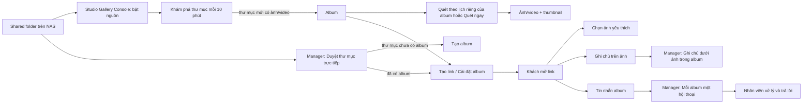

# Studio Gallery: luồng dữ liệu và giao diện

## Quy tắc mỗi phần

- **Console** chỉ quản lý quyền truy cập shared folder và lịch khám phá nguồn; không thay lịch quét riêng của album.
- **Duyệt thư mục** phản ánh cây NAS, dù thư mục đó chưa là album. Tạo album, link và mở cài đặt ngay tại thư mục đang xem.
- **Album** là đơn vị tạo link, lịch quét, nhân viên phụ trách và ghi chú nội bộ. Quét nội dung đệ quy dưới thư mục album.
- **Khách** chỉ thấy nội dung thuộc link và quyền được cấp. Ghi chú trên ảnh có thể ghim vị trí hoặc gửi không ghim; tin nhắn album là kênh chung của album.
- **Tin nhắn album** là một dòng thời gian chung cho mỗi album: chat (không gắn ảnh) và ghi chú trên ảnh (có thể ghim vị trí). Cả khách và studio đều trả lời được ở cả hai nơi; tin của studio ký tên "Tên studio · Tên nhân viên".
- **Đã đọc** dùng con trỏ theo thứ tự tin: nhân viên dùng chung một con trỏ cho mỗi album, mỗi link khách có con trỏ riêng. Huy hiệu bên trái đếm tin khách mới (chat và ghi chú ảnh); nút chat của khách đếm tin studio mới trong phạm vi link.
- **Ghi chú ảnh của khách** có trạng thái Đã xử lý/Mở lại cho editor. Ghi chú nội bộ của album không gửi cho khách.
- **Thông báo** (chuông trên Manager): khách nhắn tin, ghi chú ảnh, chốt hoặc mở lại danh sách. Có âm báo và thông báo trình duyệt khi tab đang ẩn.
- **Realtime** qua Server-Sent Events (`/api/client/events`, `/api/admin/events`). Sự kiện chỉ báo có thay đổi; trình duyệt tải lại qua API đã kiểm tra quyền, nên khách không nhận nội dung ngoài phạm vi link. Proxy phía trước phải tắt buffering cho `/api/` (đã cấu hình trong nginx và gateway DSM).
- **Quy trình album**: Khách đang chọn → Khách đã gửi (khoá) → Đang chỉnh sửa → Đã trả ảnh. Khách bấm *Gửi studio* để khoá tim, ảnh chọn edit và danh sách; chỉ studio mở khoá lại (đưa về *Khách đang chọn*).
- **Hai tầng chọn ảnh**: trái tim không giới hạn; khi album đặt *Số ảnh edit tối đa* N > 0, khách bấm biểu tượng bút để chọn tối đa N ảnh cần chỉnh sửa. N = 0 giữ cách cũ: danh sách edit là toàn bộ ảnh đã tim.
- **Danh sách edit** (tab trong album): ảnh cần chỉnh kèm ghi chú của khách, đánh dấu *Đã xong* từng ảnh, chép tên file cho Lightroom, xuất CSV.
- **Thư mục Final** (đổi tên trong Cài đặt → Quét & chia sẻ): ảnh đã chỉnh chép vào đây không lẫn vào lưới chọn ảnh; khách thấy tab *Ảnh hoàn thiện* khi album ở trạng thái *Đã trả ảnh*.
- **Hạn trả ảnh, lời nhắn cho khách, ghi chú chung của khách** hiển thị ở Tổng quan album; khách có bộ lọc *Chưa xem* theo từng link.
- **Tài khoản khách**: tạo link có số điện thoại sẽ tạo (hoặc dùng lại) tài khoản khách; mã PIN 6 số chỉ hiện một lần kèm tin nhắn mẫu để gửi Zalo/SMS. Khách đăng nhập trang chủ bằng số điện thoại + PIN, thấy mọi album của mình, tự đổi PIN. Sai PIN 5 lần khoá 15 phút; studio cấp PIN mới hoặc mở khoá trong mục *Khách hàng*.
- **Phân công**: mỗi album chọn nhân viên phụ trách. Nhân viên đặt phạm vi *Chỉ album được giao* chỉ thấy album đó (cả hộp thư, thông báo, khách hàng).
- **Việc cần làm** (trang đầu của Manager): album khách đã gửi, đang chỉnh, quá hạn hoặc sắp đến hạn trả, tin chưa đọc, ghi chú chưa xử lý, ảnh lỗi thumbnail, khách chưa có PIN, lượt tải gần đây — trong phạm vi album tài khoản được xem.
- **Lưu trữ album** khi đã giao xong: khách không mở được (link và tài khoản), album ngừng quét, dữ liệu giữ nguyên; khôi phục bất cứ lúc nào. **Xoá album** (chỉ quản trị viên, album phải đang lưu trữ, gõ đúng tên) xoá dữ liệu và cache trong app, không xoá file ảnh; thư mục đó không tự tạo lại album khi dò nguồn (tạo album thủ công để dùng lại).
- **Lịch sử tải**: mỗi lượt khách tải ZIP được ghi lại (người tải, số file, bản gốc hay bản xem) và hiện ở Tổng quan album.
- **Watermark**: logo studio đóng lên ảnh xem trước và ZIP bản xem (góc, giữa hoặc lặp kín, chỉnh độ đậm); thumbnail, file gốc và video không bị đóng dấu.
- **RAW + JPG**: cùng tên trong một thư mục thì khách thấy một ảnh có nhãn RAW; tải file gốc kèm cả file RAW (tắt được trong Cài đặt → Quét & chia sẻ).
- **Thông báo cho studio** (Cài đặt → Thông báo): email SMTP, Telegram bot, webhook JSON; gom theo album mỗi phút, gửi lựa chọn được báo ngay; có nút Gửi thử.
- **Ngôn ngữ**: trang khách có nút VI/EN, lưu theo trình duyệt; Manager giữ tiếng Việt.
- **Lịch quét album** chọn theo phút (2–30 phút), theo giờ, hằng ngày, thủ công hoặc cron tùy chỉnh. Bản cài mới mặc định quét mỗi 10 phút.

## Trạng thái điều hướng

Manager có bốn màn hình chính: Duyệt thư mục, Hộp thư, Quản lý album, Cài đặt. Khi mở album từ thư mục hoặc hộp thư, các tab trong album gồm Tổng quan, Ảnh, Ảnh yêu thích, Cài đặt và hành động Tạo link. Quay lại phải trở về đúng màn hình đã mở album.

## Giới hạn hiện tại cần theo dõi

- Khám phá nguồn chạy mỗi 10 phút và có thể mất lâu trên NAS rất nhiều thư mục. Nó chỉ tạo album mới; album cũ theo lịch riêng.
- Thumbnail/video phụ thuộc codec có sẵn trên NAS. Tệp chưa hỗ trợ vẫn hiện trong cây thư mục nhưng có thể chưa có preview.
- Mỗi hội thoại hiển thị 500 tin gần nhất; chưa có tải thêm tin cũ.
- Lịch quét ngắn (vài phút) đọc lại toàn bộ cây thư mục album mỗi lần; với album rất lớn nên chọn 10–30 phút.
